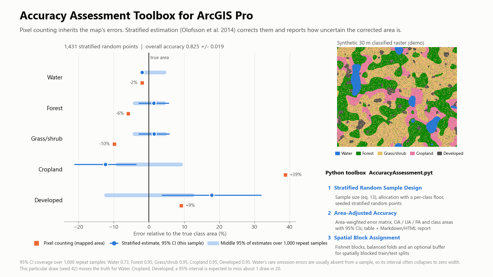

# Accuracy Assessment Toolbox for ArcGIS Pro

A Python toolbox (`.pyt`) that brings good-practice accuracy assessment and area estimation for classified rasters into ArcGIS Pro.



## The gap it fills

ArcGIS Pro's *Compute Confusion Matrix* reports sample counts, user's and producer's accuracy, overall accuracy and kappa. Those are properties of the **sample**, not of the **map**. They are only unbiased for the map when every pixel had the same chance of being sampled. Good-practice designs oversample rare classes, so that condition rarely holds. Pro also gives no confidence intervals and no estimate of the true area of each class. Area is usually the number a project actually needs.

The remote sensing standard (Olofsson et al. 2013, 2014; Stehman 2014) is to:

1. draw a **stratified random sample** with the map classes as strata and a sample size set from a target precision;
2. weight the error matrix by each class's **mapped area proportion**;
3. report overall, user's and producer's accuracy **and class areas with confidence intervals**. Mapped pixel counts are biased by commission and omission error.

This toolbox does all three inside Pro. It adds a third tool for spatially blocked train/test splits (Roberts et al. 2017), so most validation points are not close neighbours of training points. Without a buffer, points on either side of a block edge can still be close; the optional buffer removes those training points fold by fold.

## Tools

| Tool | What it does | Key outputs |
|---|---|---|
| **Stratified Random Sample Design** | Total sample size from a target SE of overall accuracy (Olofsson et al. 2014, eq. 13). Allocates it in proportion to area with a per-class minimum (e.g. 50 or 100). Draws seeded stratified random pixels. | Point feature class (`SAMPLE_ID`, `MAP_CLASS`, `STRAT_W`, empty `REF_CLASS`), optional design table |
| **Area-Adjusted Accuracy (Olofsson 2014)** | Stratified estimators of overall, user's and producer's accuracy and class area, with confidence intervals. Mapped areas come from raster pixel counts x cell area. User's accuracy intervals can be Wald (default) or Wilson. | Per-class table (incl. `UA_LO`/`UA_HI`), optional area-proportion error matrix table, Markdown or HTML report |
| **Spatial Block Assignment** | Square blocks of a user-set size (fishnet). Whole blocks are dealt to k folds, balanced by point count. Optional buffer: for each fold, training points within the buffer of that fold's test blocks are excluded. Reports counts per fold and per class. | Points with `BLOCK_ID`, `BLOCK_ROW`, `BLOCK_COL`, `FOLD`, and with a buffer `SPLIT_F1..SPLIT_Fk` (1 test, 0 train, 2 excluded); optional block polygons |

All three tools:

- validate their parameters in the dialog (projected raster, integer classes, ranges, distinct fields, table vs. feature input);
- write their progress and results to the geoprocessing messages;
- ship with tool and parameter help in the `*.pyt.xml` metadata files.

The estimators assume the reference sample was stratified by the map classes of this raster (or is a simple random sample). If the sample was stratified by something else, such as an older map, the Stehman (2014) estimators are needed instead; they are not implemented here.

Inputs can be a classified raster plus reference points, or a plain table that has map and reference class fields. Rasters are read in row blocks, so large rasters do not need to fit in memory. NoData cells are excluded even when the raster does not report a NoData value.

## Install

1. Download or clone this repository.
2. In ArcGIS Pro, open the **Catalog** pane, right-click **Toolboxes** > **Add Toolbox**, and pick `AccuracyAssessment.pyt`.
3. Run the tools from the Catalog pane, or from Python:

```python
import arcpy
arcpy.ImportToolbox(r"C:\path\to\arcgis-accuracy-toolbox\AccuracyAssessment.pyt")
arcpy.accuracy.StratifiedSampleDesign(r"C:\data\lc.gdb\landcover", r"C:\data\lc.gdb\samples",
                                      target_se=0.01, default_users_accuracy=0.8,
                                      min_per_class=50, seed=42)
# ...label REF_CLASS from imagery or field data, then:
arcpy.accuracy.AreaAdjustedAccuracy(r"C:\data\lc.gdb\samples", "REF_CLASS", "MAP_CLASS",
                                    r"C:\data\lc.gdb\landcover", r"C:\data\lc.gdb\accuracy",
                                    r"C:\data\accuracy_report.html", 95)
```

Requirements: ArcGIS Pro 3.x with its default `arcgispro-py3` environment (numpy, plus matplotlib for the demo figure). No extensions or extra packages are needed. The tools do not use Spatial Analyst.

## The math

Notation: `n_ij` is the sample count with map class *i* (row) and reference class *j* (column). `n_i.` is the row total. `W_i` is the mapped area proportion of class *i*. `A` is the total mapped area.

**Sample size** (Olofsson et al. 2014, eq. 13; after Cochran 1977). `U_i` are the anticipated user's accuracies and `S(Ô)` is the target standard error of overall accuracy:

```
n = ( Σ W_i S_i )² / ( S(Ô)² + (1/N) Σ W_i S_i² ),   S_i = sqrt( U_i (1 − U_i) )
```

Allocation: classes whose proportional share is below the minimum get the minimum. The rest of the sample is shared in proportion to area. The total grows only if the minimums alone exceed it.

**Estimated area proportions:**

```
p̂_ij = W_i · n_ij / n_i.
```

**Accuracy:**

```
Ô    = Σ_j p̂_jj                     V(Ô)   = Σ_i W_i² Û_i (1 − Û_i) / (n_i. − 1)
Û_i  = p̂_ii / p̂_i.                  V(Û_i) = Û_i (1 − Û_i) / (n_i. − 1)
P̂_j  = p̂_jj / p̂_.j
V(P̂_j) = 1/N̂_.j² · [ N_j.² (1 − P̂_j)² Û_j (1 − Û_j) / (n_j. − 1)
                    + P̂_j² Σ_{i≠j} N_i.² (n_ij / n_i.)(1 − n_ij / n_i.) / (n_i. − 1) ]
```

Here `N_i.` is the mapped size of stratum *i* and `N̂_.j = Σ_i N_i. n_ij / n_i.`.

**Area of class k** with its confidence interval:

```
Â_k = A · p̂_.k        S(p̂_.k) = sqrt( Σ_i (W_i p̂_ik − p̂_ik²) / (n_i. − 1) )
CI  = Â_k ± z · A · S(p̂_.k)      (z = 1.96 for 95%)
```

**User's accuracy interval options.** The default is the Wald interval `Û_i ± z·sqrt(V(Û_i))` used by Olofsson et al. (2014). It has zero width when every sample in a stratum agrees with the reference (Û = 1) or none does (Û = 0), and it tends to under-cover near 0 or 1 with small n. The **Wilson** score interval (Wilson 1927) is available as an option, computed within each map stratum (n = n_i.):

```
centre = (Û + z²/2n) / (1 + z²/n)      half-width = z/(1 + z²/n) · sqrt( Û(1 − Û)/n + z²/4n² )
```

Whatever option is chosen, when a user's accuracy is exactly 0 or 1 the report and messages give its Wilson interval and say that "no errors observed" does not mean "no uncertainty". Overall accuracy, producer's accuracy and areas always use the Wald intervals of Olofsson et al.

The report also prints the unweighted sample overall accuracy and kappa for comparison with *Compute Confusion Matrix*. Kappa is not recommended for assessing accuracy (Olofsson et al. 2014).

**Spatial blocks:** each point gets a block row and column from `floor((x − x0)/s)` and `floor((y − y0)/s)`. The grid origin snaps to multiples of the block size `s`. Blocks are shuffled with the seed, then dealt largest-first to the fold that holds the fewest points so far.

**Buffer (optional):** for fold *f* as the test set, a training point is excluded (`SPLIT_Ff = 2`) if its distance to the nearest edge of any occupied fold-*f* block is at most the buffer distance *b*. Train on `SPLIT_Ff = 0` and test on `SPLIT_Ff = 1`. Only blocks within `ceil(b/s)` rows or columns of a point need to be checked. The tool warns when a buffer removes more than half of a fold's training points. This follows the buffered blocking idea in Roberts et al. (2017). It reduces, but does not remove, spatial dependence between training and test points.

## Validation against Olofsson et al. (2014)

`tests/test_accuracy_core.py` reproduces the worked example in Olofsson et al. (2014). That example has four classes: deforestation, forest gain, stable forest and stable non-forest. The mapped areas are 200,000, 150,000, 3,200,000 and 6,450,000 Landsat pixels, and the sample totals 640 points. The sample counts below are the paper's Table 8, as encoded in the example of the `mapaccuracy` R package:

| Map \ Reference | Defor. | Gain | Stable forest | Stable non-forest |
|---|---:|---:|---:|---:|
| Deforestation | 66 | 0 | 5 | 4 |
| Forest gain | 0 | 55 | 8 | 12 |
| Stable forest | 1 | 0 | 153 | 11 |
| Stable non-forest | 2 | 1 | 9 | 313 |

| Quantity | This toolbox | Published |
|---|---|---|
| Deforestation area | 21,158 ± 6,158 ha | 21,158 ± 6,158 ha |
| Forest gain area | 11,686 ± 3,756 ha | 11,686 ± 3,756 ha |
| Stable forest area | 285,770 ± 15,510 ha | 285,770 ± 15,510 ha |
| Stable non-forest area | 581,386 ± 16,282 ha | 581,386 ± 16,282 ha |
| User's accuracy | 0.88, 0.73, 0.93, 0.96 | 0.88, 0.73, 0.93, 0.96 |
| Producer's accuracy | 0.75, 0.85, 0.93, 0.96 | 0.75, 0.85, 0.93, 0.96 |
| Overall accuracy | 0.947 ± 0.018 | 0.95 ± 0.02 |
| Sample size for U = 0.7, 0.6, 0.9, 0.95 and S(Ô) = 0.01 | 641 | 641 |

The test suite also checks the following:

- **Analytic standard errors match the real spread of estimates.** A Monte Carlo test redraws 1,500 stratified samples from a synthetic population with known truth. For area, user's, producer's and overall accuracy, the analytic SE is within 10% of the observed standard deviation of the estimates. The 95% intervals for area cover the truth 92–98% of the time, and the area estimator is unbiased.
- **Block-wise sampling selects the right pixels.** The pixel selector returns identical picks whether the raster is read whole or in blocks, and each pick matches its stratum.
- **Wilson intervals and the buffer behave as specified.** Wilson bounds are checked against known values (0 of 10 gives an upper bound of 0.2775). The buffered split is checked against a hand-worked example and a brute-force distance check on 400 random points.
- **The fold assignment balances and repeats.** Folds come out balanced and the same seed reproduces them.

Run the tests with ArcGIS Pro's Python (no ArcPy needed for the math):

```
"C:\Program Files\ArcGIS\Pro\bin\Python\envs\arcgispro-py3\python.exe" -m pytest tests
```

## Demo

`demo/run_demo.py` runs all three tools end to end with `arcpy.ImportToolbox`, on a synthetic map built for the demo:

- **True land cover:** a 30 m raster (800 x 1000 cells, 5 classes, NAD83 / Conus Albers) with a NoData collar.
- **Map:** made from the true raster with known per-pixel confusion rates. For example, 15% of grass/shrub is mapped as cropland.

Because the true areas are known, the estimates can be checked against the truth.

```
"C:\Program Files\ArcGIS\Pro\bin\Python\envs\arcgispro-py3\python.exe" demo\run_demo.py
```

Results on ArcGIS Pro 3.7.2 (seed 42; full report in [docs/example_report.md](docs/example_report.md)):

- **Sample design:** eq. 13 gives n = 1,431 for S(Ô) = 0.01 with a 100-point floor. Allocation: water 100, forest 417, grass/shrub 530, cropland 284, developed 100.
- **Overall accuracy:** 0.825 ± 0.019 area-weighted, against 0.829 for the unweighted sample.

| Class | True area (ha) | Pixel counting (ha) | Stratified estimate (ha, 95% CI) | CI coverage over 1,000 repeat samples |
|---|---:|---:|---:|---:|
| Water | 3,220 | 3,157 | 3,157 ± 0 | 0.73 |
| Forest | 22,394 | 21,078 | 22,696 ± 949 | 0.95 |
| Grass/shrub | 29,744 | 26,807 | 30,178 ± 1,281 | 0.95 |
| Cropland | 10,329 | 14,332 (+39%) | 9,046 ± 900 | 0.95 |
| Developed | 3,432 | 3,745 | 4,043 ± 483 | 0.95 |

How to read the demo results:

- **Pixel counting is far off for cropland.** It overstates cropland by 39%, because grass mapped as cropland is common.
- **The stratified estimator is unbiased.** Across 1,000 repeat samples of the same design, the estimates centre on the true areas. Their 95% intervals cover the truth about 95% of the time.
- **This particular draw (seed 42) is an unlucky one.** Its cropland and developed intervals miss the truth, which happens for about 1 draw in 20 per class. The seed is left as it was rather than picked for a nicer figure.
- **Water shows a known limitation.** The demo map has no commission errors into water, and water's omission errors are rare (2% of water mapped as forest), so they are usually absent from the forest sample. The interval then collapses to zero width and misses the truth, as it does in this draw. The report flags this as "no errors observed, not no uncertainty" and gives the Wilson interval for water's user's accuracy (0.963 to 1.000).

**Spatial blocks:** with 2 km blocks and 5 folds, 179 occupied blocks are dealt into folds of 285–287 points each, and every class appears in every fold. With a 250 m buffer, 101–119 training points per fold (9–10% of each fold's training set) are excluded because they sit within 250 m of that fold's test blocks.

## Repository layout

```
AccuracyAssessment.pyt          Python toolbox (parameters, validation, I/O, messages)
AccuracyAssessment.*.pyt.xml    Tool and parameter help shown in ArcGIS Pro
accuracy_core.py                All estimators (numpy only, unit tested)
tests/test_accuracy_core.py     pytest suite, including the Olofsson et al. (2014) example
demo/run_demo.py                Synthetic end-to-end demo via arcpy.ImportToolbox
docs/example_report.md          Report written by the demo
docs/hero.png                   Figure above
tools/build_metadata.py         Regenerates the *.pyt.xml help from one help dictionary
```

## References

- Cochran, W. G. (1977). *Sampling Techniques* (3rd ed.). Wiley.
- Congalton, R. G., & Green, K. (2019). *Assessing the Accuracy of Remotely Sensed Data: Principles and Practices* (3rd ed.). CRC Press.
- Olofsson, P., Foody, G. M., Stehman, S. V., & Woodcock, C. E. (2013). Making better use of accuracy data in land change studies: Estimating accuracy and area and quantifying uncertainty using stratified estimation. *Remote Sensing of Environment*, 129, 122–131.
- Olofsson, P., Foody, G. M., Herold, M., Stehman, S. V., Woodcock, C. E., & Wulder, M. A. (2014). Good practices for estimating area and assessing accuracy of land change. *Remote Sensing of Environment*, 148, 42–57.
- Roberts, D. R., Bahn, V., Ciuti, S., Boyce, M. S., Elith, J., Guillera-Arroita, G., Hauenstein, S., Lahoz-Monfort, J. J., Schröder, B., Thuiller, W., Warton, D. I., Wintle, B. A., Hartig, F., & Dormann, C. F. (2017). Cross-validation strategies for data with temporal, spatial, hierarchical, or phylogenetic structure. *Ecography*, 40, 913–929.
- Wilson, E. B. (1927). Probable inference, the law of succession, and statistical inference. *Journal of the American Statistical Association*, 22, 209–212.
- Stehman, S. V. (2014). Estimating area and map accuracy for stratified random sampling when the strata are different from the map classes. *International Journal of Remote Sensing*, 35, 4923–4939.

The example error matrix counts were checked against the Olofsson et al. (2014) example as encoded in the `mapaccuracy` R package documentation (function `olofsson`).

## AI assistance

Built with an AI coding assistant (Claude Code, by Anthropic). Commits made with it carry its `Co-Authored-By` line.

## License

MIT. See [LICENSE](LICENSE).
